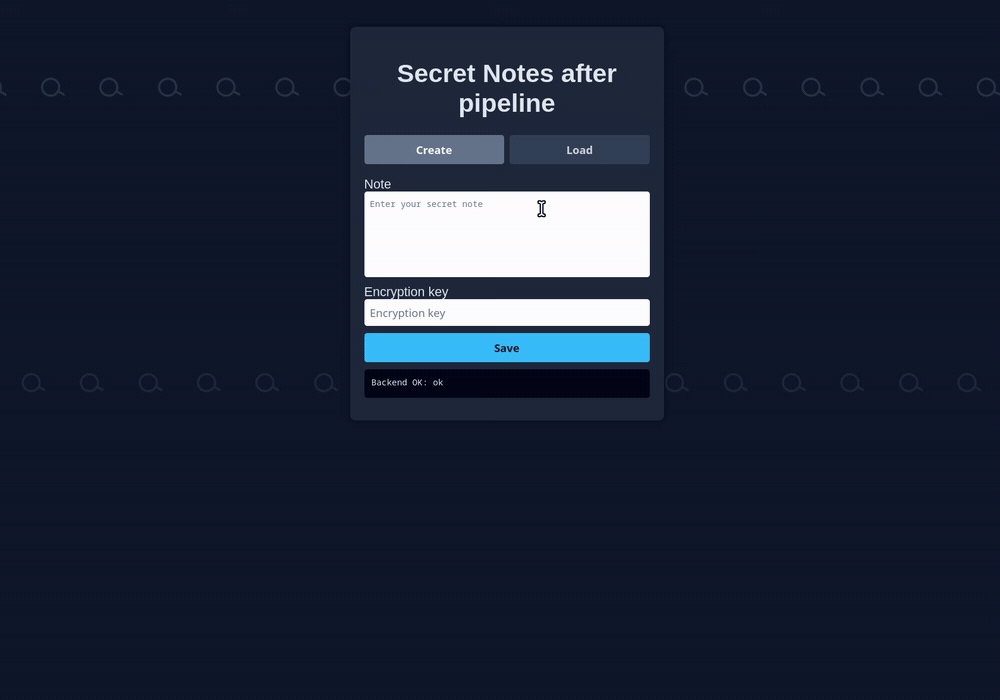
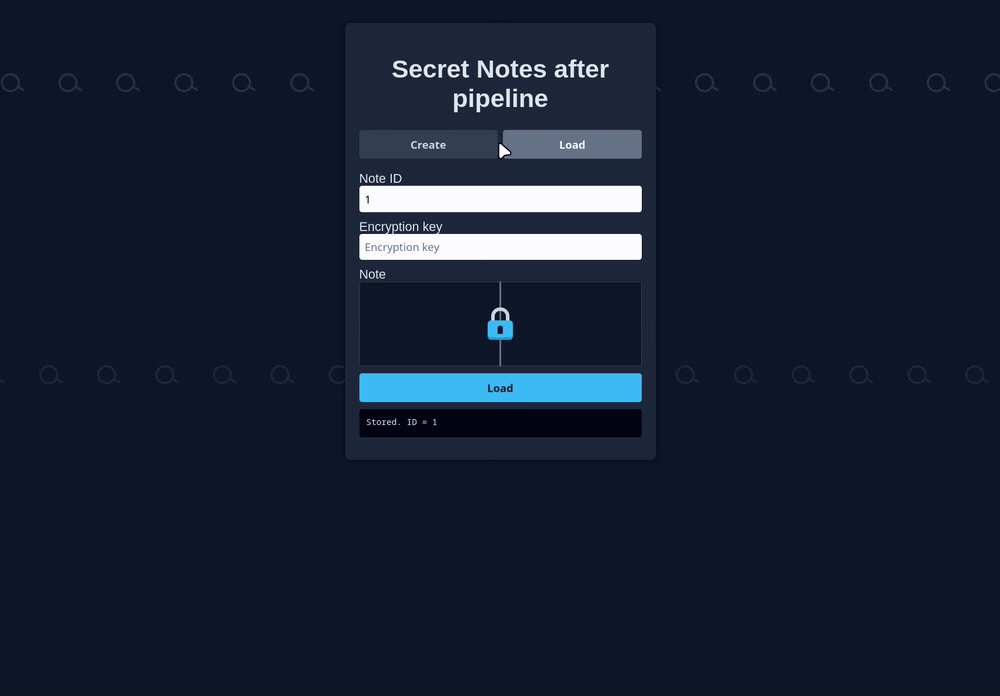

# Secret Notes

Secret Notes is a fourth-semester project at **FH Technikum Wien**, developed for the **Continuous Integration** course.

The application allows users to store encrypted notes and retrieve them using a note ID and passphrase. Its main purpose is to demonstrate an automated **CI/CD workflow**, from code quality checks and testing to container delivery and deployment on **AWS**.

The application uses a JavaScript frontend, a Node.js/Fastify backend, and PostgreSQL with Prisma. Notes are encrypted using AES-256-GCM.

## CI/CD Pipeline

The project combines two pipelines:

- **GitLab CI** handles the backend using a private runner.
- **Jenkins**, hosted on AWS, handles the frontend.

Both pipelines run validation and build stages on `main` and `deploy/production`. Publishing to Docker Hub and deployment are restricted to `deploy/production`.

### Pipeline Steps

| Step | Tools / Services | Purpose |
|---|---|---|
| Lint | ESLint | Check JavaScript code for errors and coding rule violations. |
| Security Scan | Snyk | Scan dependencies for known vulnerabilities. |
| Tests & Coverage | Jest, PostgreSQL | Run automated tests and generate coverage reports. Backend tests use a PostgreSQL service. |
| Code Quality | SonarQube | Analyze source code and test coverage, and enforce a quality gate before building. |
| Build | Docker, GitLab Container Registry | Build container images tagged with the commit SHA. Backend images are stored in the GitLab registry; frontend images are built locally by Jenkins. |
| Deliver | Docker Hub | Publish frontend and backend images for deployment. |
| Artifact Check | Docker Hub API | Jenkins checks that both images are available for the same commit before deploying the frontend. |
| Deploy | AWS EC2, Docker, Prisma | Deploy containers to the inactive Blue/Green environment. The backend pipeline also applies database migrations. |
| Performance Tests | Grafana k6 | Check API response times and error rates under load. |
| End-to-End Tests | Playwright | Validate application workflows through automated browser tests. |
| Switch | Nginx, Blue/Green scripts | Route traffic to the updated environment after the required checks pass. |
| Failure Notification | Slack Webhooks | Send a notification when a pipeline fails. |

### Blue/Green Deployment

Frontend and backend each use two container environments: **blue** and **green**. New versions are deployed to the inactive environment while the active version continues serving traffic. Each pipeline switches its component through an Nginx proxy after its tests pass.

The GitLab pipeline tests the inactive backend directly before switching. Jenkins tests the inactive frontend, while its performance tests target the backend through the active proxy.

### Supporting Services

- **AWS EC2:** Hosts Jenkins and the application containers.
- **AWS RDS for PostgreSQL:** Provides the application database.
- **GitLab Container Registry:** Stores backend build images.
- **Docker Hub:** Distributes container images to deployment hosts.
- **SonarQube and Snyk:** Provide code quality and dependency security checks.
- **Slack:** Receives pipeline failure notifications.
- **PostHog:** Provides application analytics and feature flags, independently of the deployment pipeline.
